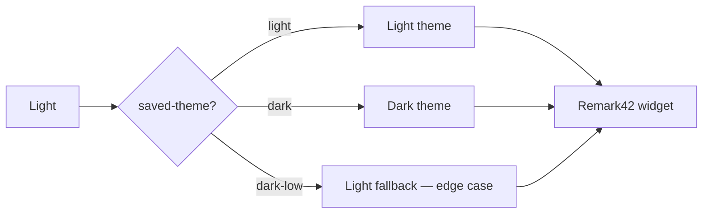

# Code, Tables & Mermaid

Syntax highlighting, wide-table scrolling, and diagrams — the surface where dark and dark-low palettes get judged hardest. Back to the [index](./index.md).

## Inline code

Inline `code` sits inside prose, next to plain text, **bold**, and a [link](./lists.md) — its background and border must survive all of them. A long token to test inline overflow: `aVeryLongIdentifierNameThatMightNotBreakNicely_inSomeContexts_0000ffff`.

## Fenced code

TypeScript, the most common highlight on the site:

```ts
/**
 * Resolves the effective theme from the stored preference, falling back
 * to the OS seed when nothing has been chosen yet.
 */
export function resolveTheme(): ThemeMode {
  const stored = localStorage.getItem(THEME_STORAGE_KEY)
  if (isThemeMode(stored)) return stored
  return window.matchMedia("(prefers-color-scheme: dark)").matches ? "dark" : "light"
}
```

CSS, where comments and selectors meet the palette directly:

```css
:root[saved-theme="dark-low"] {
  --light: #1a1712;
  --dark: #ede4d3;
  --text-highlight: oklch(0.75 0.1 80);
}
```

Python, for a different keyword/comment colour mix:

```python
def fib(n: int) -> list[int]:
    """First n Fibonacci numbers."""
    seq, a, b = [], 0, 1
    for _ in range(n):
        seq.append(a)
        a, b = b, a + b
    return seq
```

Rust, heavier on punctuation and lifetimes:

```rust
fn longest<'a>(x: &'a str, y: &'a str) -> &'a str {
    if x.len() > y.len() { x } else { y }
}
```

A shell block and a data block:

```bash
npx quartz build --serve --concurrency 1
```

```json
{ "saved-theme": ["light", "dark", "dark-low"], "hydration": false }
```

An intentionally overlong line to prove horizontal scrolling works inside the block without stretching the article column:

```text
this-line-is-deliberately-long-enough-to-overflow-any-reasonable-reading-measure-so-the-container-must-scroll-internally-and-never-widen-the-page-0123456789-abcdefghijklmnopqrstuvwxyz
```

## Wide table

Ten columns on purpose — the no-escape-hatch measure means the table container scrolls internally (`overflow-x: auto` is already in place); the page itself must never widen.

| Construct | Light | Dark | Dark-low | Heading accent | Link style | Selection | Measure | Line height | Notes |
| --- | --- | --- | --- | --- | --- | --- | --- | --- | --- |
| Headings | judged | judged | judged | step 05 | n/a | n/a | scoped | baked scale | h1–h6 |
| Body text | judged | judged | judged | n/a | n/a | n/a | 80ch | unitless | the anchor |
| Tables | judged | judged | judged | header row | n/a | n/a | scroll | unitless | wide test above |
| Code | judged | judged | judged | n/a | n/a | n/a | scroll | compact | Shiki |
| Callouts | judged | judged | judged | icon+border | inner links | n/a | scoped | compact | 12 variants |

## Mermaid

Diagrams follow `saved-theme`: `"dark"` gets the dark theme, everything else — including `dark-low` — currently falls back to light. The dark-low rendering of this diagram is the known edge case to check and record.



## Indented code

An indented code block, the legacy form, still worth judging:

    const legacy = "indented block, not fenced"
